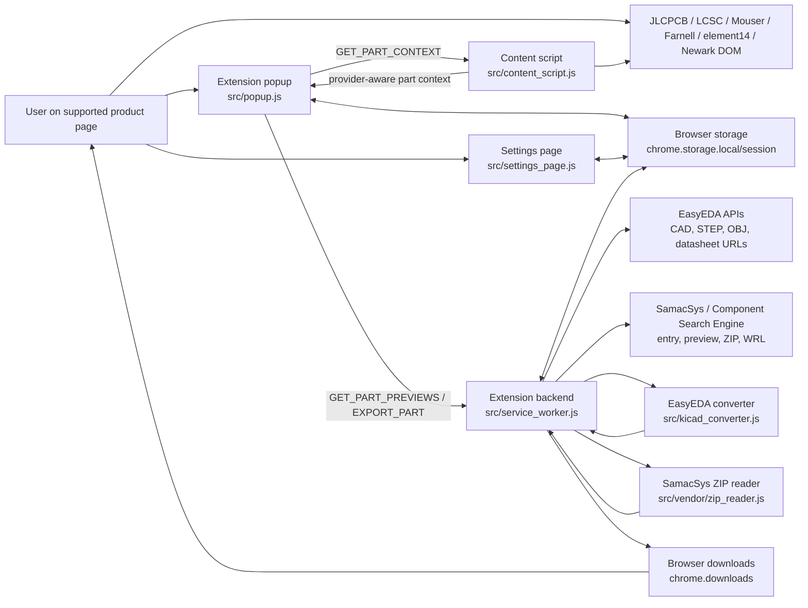

# System Design: Easy ECAD Downloader

## 1. Purpose

This document describes the current implemented design of the Easy ECAD Downloader browser extension.

The extension supports three provider flows:

- EasyEDA-backed JLCPCB and LCSC pages
- Mouser pages that expose the SamacSys / Component Search Engine ECAD button
- Farnell, element14, and Newark pages that expose the Supplyframe / SamacSys ECAD link

The repository remains intentionally compact. If code and design diverge, update one of them in the same change.

## 2. Implemented workflow

### 2.1 Supported operator flow

1. Open a supported JLCPCB, LCSC, Mouser, Farnell, element14, or Newark product page.
2. Optionally open the extension settings page to configure download layout or advanced SamacSys options.
3. Open the extension popup.
4. Ask the content script for a provider-aware part context via `GET_PART_CONTEXT`.
5. Ask the service worker for `GET_PART_PREVIEWS`.
6. Choose which artifacts to export.
7. Ask the service worker to export the current part with `EXPORT_PART`.

### 2.2 Explicit non-goals

The current repository does not implement:

- browser automation outside the popup/content-script/service-worker model
- end-to-end browser-run integration tests in real Firefox
- a project-hosted proxy or cloud backend for Mouser / SamacSys Firefox support
- a broader application-layer architecture beyond the existing file split

## 3. Supported contexts and assumptions

- The content script is injected only on matching JLCPCB, LCSC, Mouser, Farnell, element14, and Newark pages.
- EasyEDA-backed pages expose an LCSC-style part id such as `C12345`.
- Mouser support depends on the ECAD button `#lnk_CadModel[data-testid="ProductInfoECAD"]`.
- Farnell, element14, and Newark support depend on a Supplyframe / SamacSys link exposed in the `ECAD / MCAD` section.
- The content script returns a generic part context, not a provider-specific ad hoc message shape.
- EasyEDA previews are generated locally from CAD payload primitives.
- SamacSys distributor previews come from SamacSys JSON preview endpoints and are displayed as PNG data URLs.
- EasyEDA datasheet availability comes from URLs exposed by the upstream payload.
- SamacSys distributor datasheet export is currently unsupported.
- SamacSys distributor preview and export work directly in Chrome.
- Firefox SamacSys support is opt-in and depends on a user-managed relay URL stored by the extension settings page.
- SamacSys ZIP export may still require upstream authentication.
- On Chrome direct requests, the worker first tries the normal browser session and retries the ZIP request once with configured upstream auth if the first ZIP request returns `401`.
- On Firefox relay mode, the worker uses the relay path and returns a sign-in-required error if the upstream ZIP request remains unauthorized.
- In Firefox relay mode, the service worker forwards matching `componentsearchengine.com` cookies through the relay so authenticated ZIP downloads can reuse the user's upstream browser session.
- Firefox relay mode can send a separate relay `Authorization` header on the Worker POST when the user configures helper-service auth.
- Firefox relay mode can forward an upstream SamacSys `Authorization` header for ZIP endpoints that rely on HTTP Basic auth instead of cookies alone.
- The Manifest V3 background is declared for both Chrome and Firefox: Chrome uses `background.service_worker`, while Firefox uses the background-document fallback from `background.scripts`. This combined manifest relies on Firefox 121 or newer.
- The configurable library download root must remain relative to the browser's Downloads directory.
- Library roots reject traversal, control characters and Windows-invalid filename punctuation, while retaining nested folders, Unicode and ordinary spaces.

## 4. Repository architecture

### 4.1 User-to-backend flow

There is no application-owned cloud backend in this repository. The service worker is the browser-local backend boundary, and it calls external upstream provider services when previews or exports require network data.

### 4.2 `src/content_script.js`

Owns page inspection only:

- resolve EasyEDA/LCSC identifiers from supported product URLs and complete labelled product fields, rejecting conflicting identities
- detect Mouser SamacSys ECAD availability from the ECAD button
- detect Farnell, element14, or Newark SamacSys ECAD availability from the `Supply Frame Models Link`
- read provider-specific source part metadata from the page DOM
- reconstruct the Mouser SamacSys entry URL from `loadPartDiv(...)`
- reconstruct the Farnell, element14, or Newark SamacSys entry URL from the Supplyframe link metadata
- reply to popup-originated `GET_PART_CONTEXT` requests

It remains a DOM-reading boundary with no network or download logic.

### 4.3 `src/popup.js`

Owns popup UI state and user interaction:

- cache popup DOM elements
- load current settings from extension storage for provider gating
- query the active tab and request the current provider-aware part context
- render the fixed `Mfr. Part #` row plus a dynamic provider-specific source row
- request previews and datasheet availability
- gate downloads based on provider support and checkbox selection
- open the dedicated settings page from the popup settings button
- send `EXPORT_PART` requests to the service worker
- keep Download disabled until the pending export receives its worker response, including while selections change
- wait for saved settings before preview/export requests and keep exports disabled after a storage-read failure

It remains the UI-facing boundary. It does not own fetch, archive extraction, or conversion logic.

### 4.4 `src/settings_page.js`

Owns persistent settings UI:

- load and save ordinary settings through `chrome.storage.local`
- keep helper tokens and SamacSys credentials in `chrome.storage.session` unless the user explicitly opts to remember them on this device
- keep form edits local to the page until the user chooses `Save`, with `Discard` restoring the last loaded settings
- expose the download layout controls, including loose-file mode and library folder root
- expose SamacSys username/password auth inputs for Mouser/Farnell/element14/Newark downloads
- let users temporarily show or hide typed password and token values without changing stored settings
- expose Firefox-only helper-service auth and relay URL inside a hidden-by-default advanced Firefox settings menu
- normalize settings through `src/core/settings.js`
- suspend form interaction during Save and restore previous local settings if session-secret migration fails; failed restoration reports a partial save requiring reload
- keep the form inert until its initial local/session snapshot loads; failed reads require reload and preserve saved values, with status messages outside the inert form

It does not request part contexts, previews, exports, or downloads.

### 4.5 `src/service_worker.js`

Owns runtime registration only:

- register the Manifest V3 background message listener
- delegate request handling to the runtime/router module

The operational core now lives behind this entrypoint rather than inside one file.

### 4.6 `src/service_worker_runtime.js` and supporting modules

Own the service-worker backend orchestration:

- normalize part context and route preview/export requests by provider
- enforce runtime-specific blocking such as Firefox SamacSys gating when no relay is configured
- compose source adapters with shared download, storage, and settings helpers
- shape success and error responses back to the popup

The runtime is intentionally split into:

- source adapters under `src/sources/`
- shared worker business logic under `src/core/`

Within `src/sources/`, the current SamacSys-backed distributors share:

- `src/sources/samacsys_distributor_adapter.js` for provider-facing preview/export orchestration
- `src/sources/samacsys_common.js` for shared SamacSys page, preview, ZIP, and asset-rewrite helpers

This keeps the message boundary stable while allowing future sources to be added without expanding the entrypoint.

### 4.7 `src/kicad_converter.js`

Keeps the public conversion API stable and delegates implementation to focused converter modules under `src/kicad/`.

Those modules own:

- EasyEDA symbol parsing
- EasyEDA footprint parsing
- coordinate, unit, and text-style conversion
- KiCad symbol text generation
- KiCad footprint text generation
- OBJ-to-WRL conversion

KiCad text serialization escapes display strings separately from library-ID normalization. Footprint TRACK/RECT graphics use a single mapped layer and convert source widths to millimetres. Circular symbol arcs derive their midpoint from the effective SVG radius and the symbol coordinate system's sweep direction.

Symbol PT export accepts absolute M/L/Z with spaces, commas or attached command letters through the shared path parser; previews retain broader native SVG support.

Absolute PT subpaths remain separate; repeated coordinate pairs, adjacent signed numbers and exponent notation follow SVG numeric syntax. Footprint pads preserve explicit non-plated-hole flags and normalize arbitrary whitespace in custom polygon coordinates. OBJ conversion supports default-material faces and negative indices relative to the vertex list at each face, and rejects invalid geometry before WRL output.

Remaining symbol-export fidelity defects include omitted noncircular ellipses and curved/relative PT paths, plus circular approximation of unequal-radii arc records. Native SVG previews accept broader geometry, so preview appearance alone does not establish exported-symbol fidelity. These remain unresolved review findings.

Mouser parts do not flow through this converter for symbol or footprint generation because the upstream ZIP already contains KiCad assets.

### 4.8 `src/vendor/zip_reader.js`

Owns small runtime archive extraction support:

- ZIP central-directory parsing
- stored-entry reads
- deflate-entry reads through runtime decompression primitives
- classic single-disk ZIP header, CRC-32 and expanded-length validation, with a 256 MiB total expansion ceiling

It exists so the service worker can extract the KiCad subtree from the SamacSys ZIP without adding a build step.

### 4.9 `tests`

The test suite remains the primary regression net for:

- page-detection logic
- popup state transitions and messaging
- service-worker orchestration and download behavior
- EasyEDA conversion behavior
- repository governance and footer discipline

`tests/headless-qa/` adds an opt-in Windows integration harness. Pinned Puppeteer and its headed Chrome for Testing binary load the actual unpacked extension in an isolated profile on a private Win32 desktop, activate the product tab there, and open its real action popup.

Chrome starts without an initial window; its first window is explicitly created minimized/unfocused, then restored only on that private desktop for popup and screenshot rendering. The input desktop is never switched. A standard-library Python launcher forwards the inherited CDP pipe descriptors and starts Chrome suspended until assigned to a kill-on-close Windows job. No debugging port, normal-profile session, foreground fallback or headless fallback is used. The configured QA Python interpreter runs both this launcher and rendering helpers.

The harness records independent page fields, real content-script context, popup preview states and completed browser downloads in atomic per-stage evidence. KiCad 10 CLI and Python render all symbol/footprint entries and temporary inspection boards with unchanged model references; a known-good relative-path fixture calibrates assembly rendering. Generated assets and evidence remain in gitignored output. Each browser run creates separate short profile and download directories under the system temporary directory, avoiding extension-storage failures and evidence-path-induced filename truncation. Final browser filenames and bytes are preserved in the run's downloads tree with size and SHA-256 checks; browser events retain their actual acquisition destinations. The launcher exits after Chrome and its descendants stop and the private desktop is released. An atomic cleanup receipt must confirm this before temporary-directory cleanup; missing confirmation retains the directories and records BLOCKED. Terminal cancellation requests owned-job termination; abrupt launcher exit also terminates the job. Failed preservation or unaccounted partial files retain the acquisition directory for recovery. These tools do not change production behavior or repair export defects.

Harness schema 2 distinguishes historical download events from verified final assets, including intentional grouped-symbol-library overwrites and known symbol-entry retention. Page/detection/popup identifiers are compared separately, and early bounded runtime diagnostics keep unknown causes distinct from explicit access blockers. Every downloaded model is inventoried; unreferenced models use labelled derived importer fixtures without asserting association or alignment. Native board bounds include circle/arc extents and rotated pads. Legacy arc syntax is translated only in embedded fixture copies for modern board compatibility, with normalization metadata; zero-radius point arcs are retained and reported without geometry repair. Model references and transforms remain unchanged. Model-sized derived outlines and bounded camera fitting prevent fixed-size fixtures from silently clipping large models; fitted images still require visual assessment. Back-side layer views are included when relevant, and coverage records outstanding inspections separately from completed execution. Structural redaction applies before evidence serialization; downloaded originals remain unchanged. Unauthenticated isolated profiles do not import sessions or bypass provider restrictions.

Browser QA remains unauthenticated by default. Opt-in `--samacsys-login` reuses a checkout-scoped Windows cache or reads visible username/password input from an interactive terminal when empty. `qa:auth` populates this cache independently; `qa:auth -- --clear` discards it. Before a new full matrix, `qa:auth -- --terminal` opens a separate visible credential console and waits for a successful exit before baseline/preflight/case execution. Its child `--prompt` mode requests a fresh pair; valid submission replaces the cache, while cancellation or invalid input preserves the old pair and blocks startup. A PowerShell launcher creates the user console with unredirected input/output, observes its exit status, and closes it on parent cancellation/EOF or the 15-minute setup timeout. The parent captures no credential-console transcript. Subsequent SamacSys rows use `--samacsys-login`; narrow/default browser runs remain unauthenticated unless opted in. A private-pipe PowerShell helper encrypts both fields with current-user DPAPI in fresh GUID-named volatile registry keys, serializes access with a named mutex and never logs responses. Volatile payloads survive terminal/browser closure and failed runs but clear on Windows restart or user-hive unload, which can occur on sign-out. Fresh secret keys prevent accidental use of an existing nonvolatile key. No secret arguments, environment variables, files or normal-profile imports are accepted. Each run provisions only trusted-context `chrome.storage.session`, forcing the existing remember flag off. The production settings/auth path consumes these values unchanged. Metadata records configuration status rather than values or login success. Exact-value redaction covers runtime echoes, including common encoded forms. Browser cleanup and per-run reference disposal leave the Windows cache available to subsequent runs. Distributor login and navigation restrictions remain separate from SamacSys authentication.

Product-navigation transport errors block the browser component workflow before detection or export; they retain an unknown cause rather than being attributed to SamacSys or credentials. The harness also recognizes the production SamacSys sign-in message and entry/preview/ZIP HTTP 401, 403 and 429 errors as external blockers. A blank-page environment preflight and credential provisioning do not establish distributor-page access or successful upstream authentication.

## 5. Core data flow

### 5.1 Detect the current part

- The popup queries the active tab.
- The popup asks the content script for `GET_PART_CONTEXT`.
- On EasyEDA-backed pages, the content script returns:
  - provider `easyedaLcsc`
  - source label `LCSC part`
  - source part number equal to the detected LCSC id
  - manufacturer part number when the page exposes `Mfr. Part #` or `MPN`
  - lookup metadata containing the LCSC id
- On Mouser pages, the content script returns:
  - provider `mouserSamacsys`
  - source label `Mouser part`
  - source part number equal to `Mouser No`
  - manufacturer part number equal to `Mfr. No`
  - lookup metadata containing manufacturer name and a reconstructed SamacSys entry URL
- On Farnell, element14, and Newark pages, the content script returns:
  - provider `farnellSamacsys`
  - source label `Farnell part`, `element14 part`, or `Newark part` based on the current site
  - source part number equal to the detected page order code or page part identifier
  - manufacturer part number from the SamacSys link metadata or page text
  - lookup metadata containing manufacturer name and a reconstructed SamacSys entry URL

EasyEDA identity is recomputed for each request from the current HTTP(S) URL and labelled product fields. URL evidence requires an apex or `www` JLCPCB/LCSC host, no credentials or nonstandard port, and `/partdetail/<slug>/C<digits>` or `/product-detail/C<digits>.html` respectively. Routes are case-insensitive with one optional trailing slash; IDs remain strings with uppercase `C` and at least three digits. Slugs, queries, fragments, canonical links and JSON-LD are not identity sources.

The EasyEDA-only field reader accepts complete values under exact normalized `JLCPCB Part #` or `LCSC Part #` labels. It reads adjacent `dt`/`dd` pairs, including modern div-wrapped pairs, and two-cell `th`/`td` rows in `table.tableInfoWrap`, within `main` or otherwise the body. On LCSC, plain product-summary tables also qualify when their own accepted rows contain an exact `LCSC Part #` label and a complete catalogue ID. Visibility and ownership exclusions apply before that qualification; unanchored tables and nested-table rows cannot supply manufacturer metadata. Hidden/inert, nested, navigation/footer/aside, recommendation/related and differently linked product fields are excluded. Invalid fields do not suppress later valid ones. Shared SamacSys readers are unchanged.

One distinct ID is accepted; duplicates agree and conflicting URL/field IDs return the existing empty context, disabling previews and export. The whole-page text fallback is removed. Manufacturer metadata uses only exact normalized `Mfr. Part #` (including `MFR.Part #`) and `MPN` labels in those same supported fields. Values remain strings with punctuation, case, leading zeros and internal spaces preserved; repeated agreeing MPNs are deduplicated and conflicting MPNs are omitted. URL-derived contexts require an agreeing catalogue field before attaching an MPN. An unavailable MPN does not block previews or export for a valid catalogue identity; EasyEDA lookups continue to use the LCSC id. No identity is cached, and no network validation, observers or retries are added.

### 5.2 Request previews

- The popup asks the service worker for `GET_PART_PREVIEWS`.
- EasyEDA-backed pages:
  - fetch the EasyEDA CAD payload
  - synthesize symbol and footprint SVG previews
  - render symbol `PT` records as escaped native SVG paths, preserving source coordinates and draw order alongside pins, rectangles, `PL`/`PG`, circles and arcs
  - keep symbol `PT`/`PL`/`PG` paint local to each shape: hex and basic named solid colors use the dark foreground, white uses the preview background, and absent, `none`, transparent or unsupported paints remain unfilled; existing stroke styling stays monochrome
  - derive datasheet availability from the payload
  - escape SVG path data and coerce numeric bounds before adding margins
- Mouser, Farnell, element14, and Newark pages:
  - fetch the SamacSys entry URL
  - follow the part-page redirect and parse the ZIP form and preview token
  - fetch `symbol.php` and `footprint.php` JSON previews
  - return PNG data URLs
  - report datasheet unavailable
- In Firefox, those same SamacSys requests are sent through the optional user-managed relay when configured; otherwise they fail early with the existing proxy-required error.
- In Firefox relay mode, the worker attaches the current SamacSys cookie header to proxied requests when browser cookies are available.
- In Firefox relay mode, the worker sends any configured relay `Authorization` header only on the Worker POST itself.
- In Firefox relay mode, the worker forwards upstream SamacSys `Authorization` only when it can generate one from configured SamacSys username/password credentials.
### 5.3 Export EasyEDA-backed parts

- The service worker fetches the EasyEDA payload using the detected LCSC id.
- The converter produces KiCad symbol and footprint text.
- Symbol, footprint, 3D, and datasheet exports follow the existing current-provider settings:
  - loose-file downloads when `downloadIndividually` is `true`
  - KiCad-style library structure when `downloadIndividually` is `false`
- Library-mode symbol exports merge into a stored symbol library keyed by the resolved library root.
- Symbol-library merging scans complete root-symbol blocks, including compact and multi-symbol input, preserving existing definitions and distinguishing nested units from separate symbols.
- EasyEDA model writes opt into a terminal browser receipt, associated with the exact download ID and requested path. Ordinary artifact writers still return a count of started downloads; `downloadCount` includes acknowledged starts that subsequently fail. The popup's `Download started` status retains that meaning.
- `src/core/downloads.js` owns browser calls and Blob cleanup; `src/core/download_receipts.js` subscribes before querying the ID, requeries snapshots invalidated by events, and polls every second for missed events. Each model has a 60-second total verification budget, including a start callback bounded to 10 seconds. Missing items, query failures and timeouts produce unverified receipts and request cancellation. Blob URLs are released on terminal state or confirmed cancellation, never merely on timeout.
- Polling extension APIs keeps the active MV3 request from becoming idle. Runtime messaging returns `true` and defers its reply until model selection finishes. Worker/browser termination abandons the request; no in-memory promise or receipt is treated as durable, and restarted workers do not resume abandoned footprint generation. No permanent receipt state is stored.
- Footprint model references use only a successfully completed model's observed basename, preferring WRL over STEP. A failed/unverified WRL leaves a valid STEP selected. HTTP/fetch, browser-start, terminal interruption, verification and incompatible-location warnings remain distinct; optional model failures allow other selected assets to proceed.
- Path validation requires an absolute browser filename, no traversal/control characters, an unchanged observed model parent, the complete requested library-directory suffix at segment boundaries, and a consistent inferred Downloads root across selected model receipts. Drive, UNC and POSIX paths are handled without embedding them in portable output. Counter suffixes and truncation are retained; no prefix guessing, global filename search or overwrite policy is added.
- Portable paths retain the existing layout contract: library footprints use `../<libraryName>.3dshapes/<deliveredBasename>`; loose files use `${KIPRJMOD}/<deliveredBasename>` and must be placed together in the project. The Downloads API does not expose the default root independently. A single already-redirected initial path cannot establish that root; individual Save As overrides, changing the root during an export, or subsequent file moves are outside the verified layout. Dependent footprints retain ordinary started-only download semantics; their final destination is not independently verified.
- Rewriting escapes KiCad strings and changes only the first existing model-path token, preserving transforms, geometry and existing multiple-block behavior. When no selected model has a usable receipt, all stale `(model ...)` blocks are removed.
- EasyEDA OBJ-to-WRL conversion recenters model geometry in X/Y and bottom-aligns the model in Z. Footprint model offsets use millimetres; WRL geometry separately uses KiCad's 2.54 mm per WRL unit convention.
- Library-mode datasheet exports are written under `<libraryRoot>/datasheets/`.

### 5.4 Export SamacSys distributor parts

- The service worker fetches the SamacSys entry URL and resolves the part page.
- In Firefox with a configured relay, the service worker sends those SamacSys HTTP requests through the relay instead of fetching upstream directly.
- The configured relay URL must be the final endpoint: relay transport rejects redirects to preserve the destination of credential-bearing JSON.
- In Firefox with a configured relay, the service worker also reads the matching upstream cookies through `chrome.cookies` and forwards them with those proxied requests.
- For authenticated ZIP flows that use HTTP Basic auth, the service worker resolves upstream SamacSys `Authorization` from the shared precedence and:
  - on Chrome direct requests, retries one ZIP request with that auth after an initial `401`
  - on Firefox relay requests, forwards that auth through the relay as part of the proxied upstream request
- When helper-service auth is configured, the relay POST itself also carries a separate relay `Authorization` header that is never forwarded upstream.
- The part page supplies:
  - a stable `partID`
  - a preview token
  - ZIP download form metadata
- The service worker downloads the SamacSys ZIP and extracts only:
  - `KiCad/*.kicad_sym`
  - `KiCad/*.kicad_mod`
  - `3D/*.stp` and `3D/*.step`
  - optional `3D/*.wrl`
- Upstream entry, metadata, preview and ZIP destinations require HTTPS on `componentsearchengine.com` or its subdomains at the standard port, with empty URL credentials. The relay example validates each redirect and clears forwarded credentials on origin changes.
- ZIP extraction verifies directory/header/data bounds, declared lengths and CRC-32, and limits total expanded bytes to 256 MiB. Encrypted, multi-disk and ZIP64 metadata produce explicit unsupported-format errors.
- Loose-file mode downloads the extracted files directly into Downloads.
- Library mode repackages the extracted assets into the current KiCad structure:
  - symbol library merge into `<libraryRoot>/<libraryName>.kicad_sym`
  - footprints into `<libraryRoot>/<libraryName>.pretty/`
  - 3D assets into `<libraryRoot>/<libraryName>.3dshapes/`
- Library mode rewrites:
  - the symbol `Footprint` property to `<libraryName>:<footprintName>`
  - the footprint `(model ...)` path to `../<libraryName>.3dshapes/<modelFilename>`
- When 3D export is selected, the worker exports STEP models and any WRL files already present in the SamacSys ZIP without probing extra remote WRL endpoints.

## 6. Storage and settings behavior

- The popup stays focused on detection, previews, export selection, and opening the dedicated settings page.
- The settings page owns persistent controls for download layout, Firefox relay configuration, and optional SamacSys auth values.
- The settings page uses explicit `Save` and `Discard` actions rather than writing every field edit immediately.
- The settings page hides the advanced Firefox settings menu when opened in Chrome.
- `chrome.storage.local` stores ordinary extension settings:
  - `downloadIndividually`
  - `libraryDownloadRoot`
  - `samacsysFirefoxProxyBaseUrl`
  - `rememberSamacsysCredentials`
  - `rememberSamacsysFirefoxProxyAuthorizationHeader`
- `chrome.storage.session` stores session-only secret values by default:
  - `samacsysFirefoxProxyAuthorizationHeader`
  - `samacsysFirefoxUsername`
  - `samacsysFirefoxPassword`
- If a remember-on-this-device box is checked, the corresponding helper token or SamacSys username/password is stored in `chrome.storage.local` instead.
- `chrome.storage.local` also stores accumulated symbol library text used for append-style symbol exports in library mode.
- Stored symbol-library content is keyed by the resolved library root so separate library folders keep separate merged symbol libraries.
- Read/merge/save/download-start sequences serialize per worker/browser and library key. Storage failures propagate to the export response; download completion retains the receipt semantics described in section 5.3.

## 7. Error and warning handling

- Detection failures in the popup produce user-facing status messages and disable export.
- Service-worker preview failures return structured error responses to the popup.
- Export failures return structured error responses to the popup.
- Partial export issues that do not invalidate the whole request, such as missing selected datasheets, unavailable selected 3D models, or selected SamacSys asset categories absent from the upstream ZIP, are accumulated as warnings.
- SamacSys distributor requests in Firefox fail early with a structured unsupported error message when no relay is configured.
- Relay transport failures are surfaced distinctly from upstream SamacSys HTTP failures.
- SamacSys ZIP `401 Unauthorized` responses are rewritten into a sign-in-required error so the popup can tell the user what upstream precondition is missing.

## 8. External dependencies and browser APIs

### 8.1 Network dependencies

- EasyEDA component API for CAD payloads
- EasyEDA module endpoints for STEP and OBJ assets
- SamacSys / Component Search Engine entry page, preview JSON endpoints, and ZIP download endpoint

### 8.2 Browser APIs

- `chrome.runtime`
- `chrome.storage.local`
- `chrome.storage.session`
- `chrome.downloads`
- `chrome.cookies` for Firefox relay cookie forwarding on SamacSys requests
- `Blob` and `URL.createObjectURL`
- runtime decompression primitives used by the vendored ZIP reader

## 9. Output artifacts and naming rules

- EasyEDA symbol output uses a standalone `<lcscId>-<symbolName>.kicad_sym` file in loose mode or the shared library file in library mode.
- SamacSys distributor loose-file symbol output keeps the extracted `.kicad_sym` filename from the ZIP.
- Footprint output uses the extracted or generated `.kicad_mod` filename.
- SamacSys distributor footprint library-mode downloads rewrite the model path into the library `.3dshapes` directory.
- EasyEDA footprint downloads rewrite the first KiCad `(model ...)` path to the delivered basename from a usable completed STEP or WRL receipt, preferring WRL, and remove stale model blocks when neither receipt is usable within the portable layout.
- EasyEDA datasheet output uses a sanitized base name plus `-datasheet` and the detected extension. In library mode it is saved under `<libraryRoot>/datasheets/`.
- The library root name defaults to `easyECADDownloader` and can be changed to another Downloads-relative folder for library mode.

## 10. Maintainability and testing boundaries

- `src/kicad_converter.js` should stay the main unit-test target for pure conversion rules.
- `src/content_script.js` should stay small enough to test through DOM fixtures and message mocks.
- `src/popup.js` regression tests use DOM fixtures and mocked browser APIs. The optional background QA harness separately exercises its real action popup and downloads in Chrome for Testing.
- `src/service_worker_runtime.js` should be tested with mocked browser APIs, mocked fetch, mocked archive extraction, and controlled converter stubs.
- The current Vitest/Vite/jsdom test stack requires Node `20.19.0+`, `22.13.0+`, or `24+`.
- Optional Puppeteer browser QA requires Node `22.13.0+` or `24+`, Python `3.10+` with Pillow, and KiCad `10.x`. Deterministic JS smoke checks join normal Vitest validation; Python smoke checks run through `npm run qa:smoke`. Live service blockers and fixture renders remain distinct from successful live end-to-end validation.
- The private-desktop QA launcher checks the configured Chrome for Testing executable before starting its native helper; a missing browser reports the pinned-browser installation command rather than a downstream protocol failure.
- QA Python correctness linting uses pinned Ruff through `npm run qa:lint`. A separate `Offline QA harness` CI job installs pinned Python requirements and runs linting plus JS/Python smoke checks on Node 24 and Python 3.10.
- Browser-run rendering requires schema-2 verified final assets whose current sizes and SHA-256 hashes match the download inventory. Malformed library/model records retain outstanding inspections. Concurrent evidence saves serialize complete snapshots; final download accounting survives popup closure, and cleanup rechecks acquisition files after browser exit.
- Browser-run assembly rendering also requires every footprint model reference to resolve to a verified inventoried model; unrelated local files leave the assembly blocked and its inspections outstanding.
- Production source should not be refactored solely to make tests easier; harnesses should adapt to the existing code shape.
- Local and CI validation share `npm run validate`, which runs ESLint, Vitest, `npm audit --audit-level=moderate`, and `git diff --check`.
- GitHub Actions runs validation with `npm ci` on Node `20.19.0`, `22.13.0`, and `24.x`.
- `SECURITY.md` owns vulnerability reporting expectations and credential-handling guidance.
- Repository hygiene tests reject high-confidence secret patterns plus common local environment, archive, log, editor, and temporary files.
- Repository hygiene tests reject non-placeholder email addresses in code and fixture text while leaving documentation and canonical source footer contact details intact.
- Repository hygiene tests decode long HTTP Basic auth examples and require decoded identities to use placeholder email domains.
- Git-history security tests run those security checks across every reachable commit; CI uses a full-history checkout so rewritten or rebased branches are scanned beyond the tip tree. This is a full-validation and CI gate, not a manual per-intermediate-commit requirement while iterating locally.
- Repository hygiene tests also enforce conventional file names, lower camelCase function declarations, and maintained-file line-count limits.

## 11. Repository rules that should remain true

- Do not change extension runtime behavior casually.
- Do not reorganize production files without a real architectural reason.
- Keep browser API orchestration in the service worker, UI state in the popup, DOM extraction in the content script, and conversion rules in the converter.
- Keep governance files and hygiene tests aligned with the codebase.
